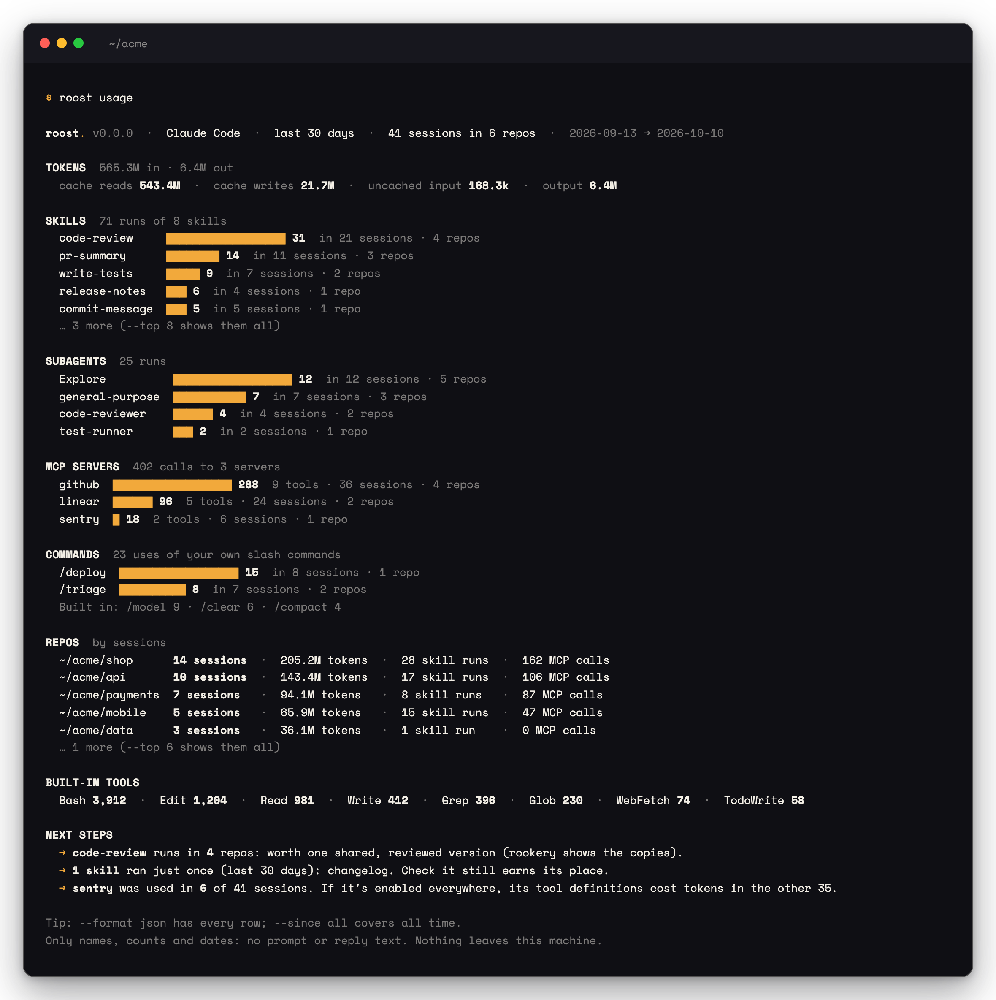
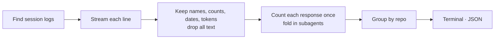

<p align="center">
  <picture>
    <source media="(prefers-color-scheme: dark)" srcset=".github/assets/roost-wordmark-bone.svg">
    
  </picture>
</p>

<h3 align="center">See what your AI agents actually use.<br>Keep what works. Retire the rest.</h3>

<p align="center">
  <a href="https://github.com/thinkingraven/roost/actions/workflows/ci.yml"></a>
  
  
  <a href="LICENSE"></a>
</p>

<p align="center">
  Claude Code · Codex · Gemini CLI
</p>

<p align="center">
  
</p>

---

Every team ends up installing a *code-review* skill, a GitHub MCP server and a dozen slash commands, in every repo and every tool. Nobody knows which ones actually run, which ones load thousands of tokens into every session and never get called, or whether the new version of a skill gets used more than the old one.

**roost** answers that from the session logs your agents already keep on your machine. It reads a few months of logs in about a second, runs locally, never uploads anything, and keeps only names, counts, dates and token numbers: never your prompts.

> **Early days.** `roost usage` reads Claude Code today. Codex and Gemini CLI, context cost and keep-or-retire verdicts are next: see the [roadmap](#roadmap).

## Quick start

Not on npm yet; it will be with the first release. From a clone:

```bash
git clone https://github.com/thinkingraven/roost.git
cd roost
npm ci && npm test

node dist/src/cli.js usage                          # the last 30 days
node dist/src/cli.js usage --since all              # all time
node dist/src/cli.js usage --format json > usage.json
node dist/src/cli.js sources                        # where each agent keeps its logs
```

No logs of your own to hand? Try it on a made-up team:

```bash
node scripts/demo-home.mjs /tmp/acme
node dist/src/cli.js usage --home /tmp/acme --since all
```

Node 20 or newer.

## What you get

| | |
|---|---|
| **Skills** | Every skill your agents actually ran: how often, in how many sessions and in how many repos. One that runs everywhere is a candidate to share; one nobody runs is a candidate to retire. |
| **Subagents** | Runs per subagent type, built-in and your own. |
| **MCP servers** | Calls per server and per tool. A server that loads its tool definitions into every session but rarely gets called is spending tokens for nothing. |
| **Your slash commands** | Uses of your team's own commands. Claude Code's built-ins (`/model`, `/clear`…) get one line of their own. |
| **Tokens per repo** | Cache reads, cache writes, uncached input and output, with each response counted once. |
| **Built-in tools** | Bash, Edit, Read and the rest, for context. |

`--format json` has every row, ready for a spreadsheet or your own dashboards.

## What it reads

| Agent | Session logs | `sources` | `usage` |
|---|---|---|---|
| **Claude Code** | `~/.claude/projects/<project>/<session>.jsonl`, with subagent logs in `<session>/subagents/` | ✓ | ✓ |
| **Codex** | `~/.codex/sessions/<yyyy>/<mm>/<dd>/rollout-*.jsonl` | ✓ | next |
| **Gemini CLI** | `~/.gemini/tmp/<project>/chats/session-*.json` | ✓ | next |
| **Cursor, GitHub Copilot** | Editor storage | later | later |

Sessions are grouped by repo: the nearest git root of the folder each one ran in. Claude Code worktrees (`<repo>/.claude/worktrees/…`) count as their repo.

`roost sources` shows what's on your machine without opening a single log:

```text
roost. v0.0.0  ·  agent session logs on this machine

  Claude Code   ~/.claude/projects   41 sessions   2026-09-13 → 2026-10-10
  Codex         ~/.codex/sessions    6 sessions    2026-09-16 → 2026-10-07
  Gemini CLI    ~/.gemini/tmp        2 sessions    2026-10-02 → 2026-10-03

Nothing leaves this machine.
```

## Options

| Option | Default | Description |
|---|---|---|
| `--since <30d\|YYYY-MM-DD\|all>` | `30d` | Time window for `usage` |
| `--top <n>` | `10` | Rows per section in the terminal report |
| `--format <terminal\|json>` | `terminal` | Output on stdout; JSON has every row |
| `--home <dir>` | your home folder | Read logs under another folder (a backup, a teammate's export, the demo) |
| `--no-color` | | Disable colour (`NO_COLOR` and `FORCE_COLOR` are respected) |
| `-v`, `--version` · `-h`, `--help` | | |

## How it works



- **Counting right.** Claude Code logs one response several times, once per content block, each copy carrying the same token usage; adding them up would more than double your totals. roost counts each response once, each tool call once, and folds subagent logs into their session. A test recovers the demo team's exact totals from 23,000 realistic log lines.
- **No guessing.** Lines roost can't read are counted and reported, never guessed at.
- **Safe names.** Skill, tool and server names come from logs, so control characters are stripped: a crafted log can't put escape codes in your terminal.

## Privacy

- Runs entirely on your machine. No network requests, no telemetry.
- `roost sources` only lists file names and dates; it never opens your logs.
- `roost usage` parses log lines to find tool calls, but keeps only names, counts, dates and token numbers. Your prompts, the agents' replies, tool inputs and tool results never reach a report, and tests check that on every change.
- Paths under your home folder are shown as `~/…`.
- Screenshots and examples here come from the made-up demo team, never real logs.

## FAQ

<details>
<summary><b>How is this different from ccusage?</b></summary>

[ccusage](https://github.com/ryoppippi/ccusage) tells you what you *spend*: tokens and cost by day, month, session and model. roost tells you what you *use*: which skills, subagents, MCP servers and commands ran, how often and in which repos. Use both.
</details>

<details>
<summary><b>Does roost read my prompts?</b></summary>

It has to parse each log line to find the tool calls in it, but it keeps nothing except names, counts, dates and token numbers. Nothing you typed and nothing the agent replied ends up in a report or on disk.
</details>

<details>
<summary><b>Why are cache reads so large?</b></summary>

Agents send the whole conversation back to the model on every turn, and most of it is read from the prompt cache, which is far cheaper than fresh input. Large cache-read totals are normal. The context-cost step on the roadmap will show how much of every session is instructions, skill descriptions and MCP tool definitions.
</details>

<details>
<summary><b>Can I see my whole team's usage?</b></summary>

Today roost reads one machine. Team summaries are on the roadmap: each person exports a counts-only file (no text, no paths outside the repo) and roost merges them into one report. Until then, `--format json` gives you a file per person to combine.
</details>

## Roadmap

- **Codex and Gemini CLI** usage
- **Context cost**: tokens loaded before the first prompt, and what each instruction file, skill description and MCP server costs per session
- **Verdicts**: join usage with [rookery](https://github.com/thinkingraven/rookery)'s inventory to say keep, improve, merge or retire, with the tokens each change saves, ending in a pull request
- **Team summaries**: counts-only exports merged into one team report
- **HTML and Markdown reports**, in rookery's style
- **npm release**: `npx @thinkingraven/roost usage`

The detailed plan is in [docs/plan.md](docs/plan.md).

## roost and rookery

[rookery](https://github.com/thinkingraven/rookery) shows what your agents *could* do: every skill in your repos, the duplicates teams keep rebuilding and the risky ones. roost shows what they *actually did*. Together they answer which skills to share, which to merge and which to retire.

## Contributing

New agent log formats, bug reports and ideas are very welcome. See [CONTRIBUTING.md](CONTRIBUTING.md). Please never paste real session logs into issues. Security issues: [SECURITY.md](SECURITY.md).

## License

[MIT](LICENSE) © [Thinking Raven](https://thinkingraven.com)
