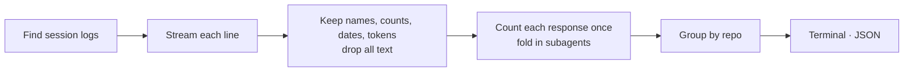

<p align="center">
  <picture>
    <source media="(prefers-color-scheme: dark)" srcset=".github/assets/roost-wordmark-bone.svg">
    
  </picture>
</p>

<h3 align="center">See what your AI agents actually use.<br>Keep what works. Retire the rest.</h3>

<p align="center">
  <a href="https://github.com/thinkingraven/roost/actions/workflows/ci.yml"></a>
  <a href="https://www.npmjs.com/package/@thinkingraven/roost"></a>
  
  
  <a href="LICENSE"></a>
</p>

<p align="center">
  Claude Code · Codex · Gemini CLI
</p>

<p align="center">
  
</p>

---

Every team ends up installing a *code-review* skill, a GitHub MCP server and a dozen slash commands, in every repo and every tool. Nobody knows which ones actually run, which ones load thousands of tokens into every session and never get called, or whether the new version of a skill gets used more than the old one.

**roost** answers that from the session logs your agents already keep on your machine. It reads a few months of logs in about a second, runs locally, never uploads anything, and keeps only names, counts, dates and token numbers: never your prompts.

> **Early days.** `roost usage` and `roost verdicts` read Claude Code, Codex and Gemini CLI. Context cost and team summaries are next: see the [roadmap](#roadmap).

## Quick start

```bash
npx @thinkingraven/roost usage                     # what your agents ran, the last 30 days
npx @thinkingraven/roost usage --agent codex       # one agent: claude-code, codex or gemini
npx @thinkingraven/roost usage --since all         # all time
npx @thinkingraven/roost sources                   # where each agent keeps its logs
npx @thinkingraven/roost decisions                 # what rookery's runtime hook blocked or warned about

# keep, fix, merge or retire each skill: rookery's inventory joined with what ran
npx @thinkingraven/rookery scan ~/code --local --format json | npx @thinkingraven/roost verdicts
```

Or install it: `npm install -g @thinkingraven/roost`, then run `roost usage`.

No logs of your own to hand? Try it on a made-up team, from a clone:

```bash
git clone https://github.com/thinkingraven/roost.git && cd roost
npm ci && npm test
node scripts/demo-home.mjs /tmp/acme
node dist/src/cli.js usage --home /tmp/acme --since all
```

Node 20 or newer.

## What you get

| | |
|---|---|
| **Skills** | Every skill your agents actually ran: how often, in how many sessions and in how many repos. One that runs everywhere is a candidate to share; one nobody runs is a candidate to retire. |
| **Subagents** | Runs per subagent type, built-in and your own. |
| **MCP servers** | Calls per server and per tool. A server that loads its tool definitions into every session but rarely gets called is spending tokens for nothing. |
| **Your slash commands** | Uses of your team's own commands. Each agent's built-ins (`/model`, `/clear`…) get one line of their own. |
| **Tokens per repo** | Cache reads, cache writes, uncached input and output, with each response counted once. |
| **Built-in tools** | Bash, Edit, Read and the rest, for context. |

`--format json` has every row, ready for a spreadsheet or your own dashboards.

## Verdicts: what to keep, fix, merge or retire

[rookery](https://github.com/thinkingraven/rookery) knows which skills, commands and subagents are installed and what's wrong with them. roost knows which ones ran. `roost verdicts` puts the two together:

```bash
npx @thinkingraven/rookery scan ~/code --local --format json | npx @thinkingraven/roost verdicts
```

| Verdict | When |
|---|---|
| **Fix first** | It's used, and rookery found quality or serious security problems in it. Fix these before anything else: people rely on them. |
| **Merge** | rookery found copies of it. The copy that's used most stays; the others merge into it. |
| **Retire** | It was available in your sessions and never ran. If a claude.ai or plugin copy with the same name ran instead, the verdict says so. |
| **Keep** | It's used, and nothing needs fixing. |
| **No data** | No session ran in its repo during the window, so there's nothing to judge. |

How roost matches them:
- **Ways a skill runs:** Claude choosing it, its name or folder name, or `/name` typed by you, all count.
- **Which agents:** a skill counts only in sessions of the agents that load it.
  - `.claude/` is Claude Code, `.codex/` is Codex, and `.gemini/` is Gemini CLI.
  - The shared `.agents/skills` folder is Codex and Gemini CLI.
  - A skill linked into another agent's folder, as `npx skills` does, counts there too.
- **Where it applies:** a project skill counts only in sessions in its repo. A personal one (`~/.claude`, `~/.agents`…) counts everywhere, and wins over a project skill with the same name, as in Claude Code.
- **Not in the scan:** names that ran but aren't in rookery's scan, such as built-in or plugin skills and repos you didn't scan, are listed separately.

rookery 0.7.2 or later matches repos exactly. Older reports are matched by folder name. Use `--since` to change the window. Claude Code keeps 30 days of logs by default (`cleanupPeriodDays`).

## Decisions: what rookery's hook blocked

[rookery's runtime hook](https://github.com/thinkingraven/rookery/blob/main/docs/policy.md#rookery-hook-enforce-the-policy-while-agents-run) checks every tool call against a repo's `.rookery.yml` while an agent works, and logs each deny or warn to `~/.rookery/decisions/`. `roost decisions` reads that log:

```bash
npx @thinkingraven/roost decisions
```

```text
roost. v0.4.0  ·  decisions  ·  rookery’s policy log  ·  last 30 days

DENIED 2  stopped before the agent ran it
WARNED 1  allowed, logged

BY RULE
  files.read_secrets    1  cat ~/.ssh/**
  RK-POL-001            1  --dangerously-skip-permissions
  RK-POL-003            1  rm -rf ~/

BY AGENT
  Claude Code 2  ·  Codex 1

BY REPO
  payments-api 2  ·  web-app 1

Nothing leaves this machine. rookery already redacts what it logs: first tokens and ~ paths only.
```

`roost export` already turns this same log into `rookery.policy` rows for a company dashboard (see below); `roost decisions` is the local, no-setup view of it. Reads `~/.rookery/decisions` by default, or `ROOKERY_HOME` if rookery's hook was configured with it.

## Send it to your dashboards

`roost export` turns the same counts into small daily summaries for your company's own OpenTelemetry backend: Grafana Cloud, Loki, OpenObserve, or any OpenTelemetry Collector. The repo ships a starter Grafana dashboard covering adoption, cost, skills that work (with team-wide verdicts) and safety.

```bash
npx @thinkingraven/roost export                    # preview: exactly what would be sent, nothing sent
ROOST_EXPORT=on npx @thinkingraven/roost export --send   # uses OTEL_EXPORTER_OTLP_ENDPOINT and _HEADERS
```

What it sends:
- **Counts only:** names, counts, dates and token numbers. A hashed person id, a team label, and repos as `host/org/repo`.
- **Never:** prompts, code, arguments, file paths or emails.
- **Finished days only:** each day is sent once.

Grafana Cloud setup, a company-wide rollout and the full list of fields: [docs/export.md](docs/export.md).

## What it reads

| Agent | Session logs | `sources` | `usage` |
|---|---|---|---|
| **Claude Code** | `~/.claude/projects/<project>/<session>.jsonl`, with subagent logs in `<session>/subagents/` | ✓ | ✓ |
| **Codex** | `~/.codex/sessions/<yyyy>/<mm>/<dd>/rollout-*.jsonl` and `archived_sessions/`, with subagent threads counted into their parent | ✓ | ✓ |
| **Gemini CLI** | `~/.gemini/tmp/<project>/chats/session-*.json` (up to v0.22) and `.jsonl`, with subagent transcripts in `chats/<session>/`; slash commands from `logs.json` | ✓ | ✓ |
| **Cursor, GitHub Copilot** | Editor storage | later | later |

Sessions are grouped by repo: the nearest git root of the folder each one ran in. Claude Code worktrees (`<repo>/.claude/worktrees/…`) count as their repo.

What each agent records differs:
- **Gemini CLI** doesn't store the folder a session ran in. roost recovers it from the project's `.project_root` file or `~/.gemini/projects.json`, and older sessions in an unregistered folder show no repo.
- **Codex** doesn't record custom slash commands, apart from `/review`.
- **Gemini CLI** only shows which command was typed in its input log (`logs.json`). roost keeps the command's name, never what follows it.

`roost sources` shows what's on your machine without opening a single log:

```text
roost. v0.0.0  ·  agent session logs on this machine

  Claude Code   ~/.claude/projects   41 sessions   2026-09-13 → 2026-10-10
  Codex         ~/.codex/sessions    6 sessions    2026-09-16 → 2026-10-07
  Gemini CLI    ~/.gemini/tmp        2 sessions    2026-10-02 → 2026-10-03

Nothing leaves this machine.
```

## Options

| Option | Default | Description |
|---|---|---|
| `--since <30d\|YYYY-MM-DD\|all>` | `30d` | Time window for `usage` |
| `--top <n>` | `10` | Rows per section in the terminal report |
| `--format <terminal\|json>` | `terminal` | Output on stdout; JSON has every row |
| `--home <dir>` | your home folder | Read logs under another folder (a backup, a teammate's export, the demo) |
| `--no-color` | | Disable colour (`NO_COLOR` and `FORCE_COLOR` are respected) |
| `-v`, `--version` · `-h`, `--help` | | |

## How it works



- **Counting right.** Each agent repeats things in its logs, and roost counts each response and each tool call once:
  - **Claude Code** logs one response once per content block, each copy carrying the same token usage.
  - **Codex** repeats its running token total, resets it when the context fills up, and copies a parent's history into a fork.
  - **Gemini CLI** appends the same message again on every update, and copies whole folders when it migrates them.

  Subagent logs fold into their session. A test recovers the demo team's exact totals from 23,000 realistic log lines.
- **No guessing.** Lines roost can't read are counted and reported, never guessed at.
- **Safe names.** Skill, tool and server names come from logs, so control characters are stripped: a crafted log can't put escape codes in your terminal.

## Privacy

- Runs entirely on your machine, with no telemetry. The one exception is opt-in: `roost export --send` posts counts to the OpenTelemetry endpoint you configure, after an explicit `ROOST_EXPORT=on`. Nothing else uses the network.
- `roost sources` only lists file names and dates; it never opens your logs.
- `roost usage` parses log lines to find tool calls, but keeps only names, counts, dates and token numbers. Your prompts, the agents' replies, tool inputs and tool results never reach a report, and tests check that on every change.
- Paths under your home folder are shown as `~/…`.
- Screenshots and examples here come from the made-up demo team, never real logs.

## FAQ

<details>
<summary><b>How is this different from ccusage?</b></summary>

[ccusage](https://github.com/ryoppippi/ccusage) tells you what you *spend*: tokens and cost by day, month, session and model. roost tells you what you *use*: which skills, subagents, MCP servers and commands ran, how often and in which repos. Use both.
</details>

<details>
<summary><b>Does roost read my prompts?</b></summary>

It has to parse each log line to find the tool calls in it, but it keeps nothing except names, counts, dates and token numbers. Nothing you typed and nothing the agent replied ends up in a report or on disk.
</details>

<details>
<summary><b>Why are cache reads so large?</b></summary>

Agents send the whole conversation back to the model on every turn, and most of it is read from the prompt cache, which is far cheaper than fresh input. Large cache-read totals are normal. The context-cost step on the roadmap will show how much of every session is instructions, skill descriptions and MCP tool definitions.
</details>

<details>
<summary><b>Can I see my whole team's usage?</b></summary>

Today roost reads one machine. Team summaries are on the roadmap: each person exports a counts-only file (no text, no paths outside the repo) and roost merges them into one report. Until then, `--format json` gives you a file per person to combine.
</details>

## Roadmap

- **Context cost**: tokens loaded before the first prompt, and what each instruction file, skill description and MCP server costs per session
- **Verdicts, next steps**: the tokens each change saves, and a pull request that retires or merges for you
- **Team summaries**: counts-only exports merged into one team report
- **HTML and Markdown reports**, in rookery's style

The detailed plan is in [docs/plan.md](docs/plan.md).

## roost and rookery

[rookery](https://github.com/thinkingraven/rookery) shows what your agents *could* do: every skill in your repos, the duplicates teams keep rebuilding and the risky ones. roost shows what they *actually did*. Together they answer which skills to share, which to merge and which to retire.

## Contributing

New agent log formats, bug reports and ideas are very welcome. See [CONTRIBUTING.md](CONTRIBUTING.md). Please never paste real session logs into issues. Security issues: [SECURITY.md](SECURITY.md).

## License

[MIT](LICENSE) © [Thinking Raven](https://thinkingraven.com)
