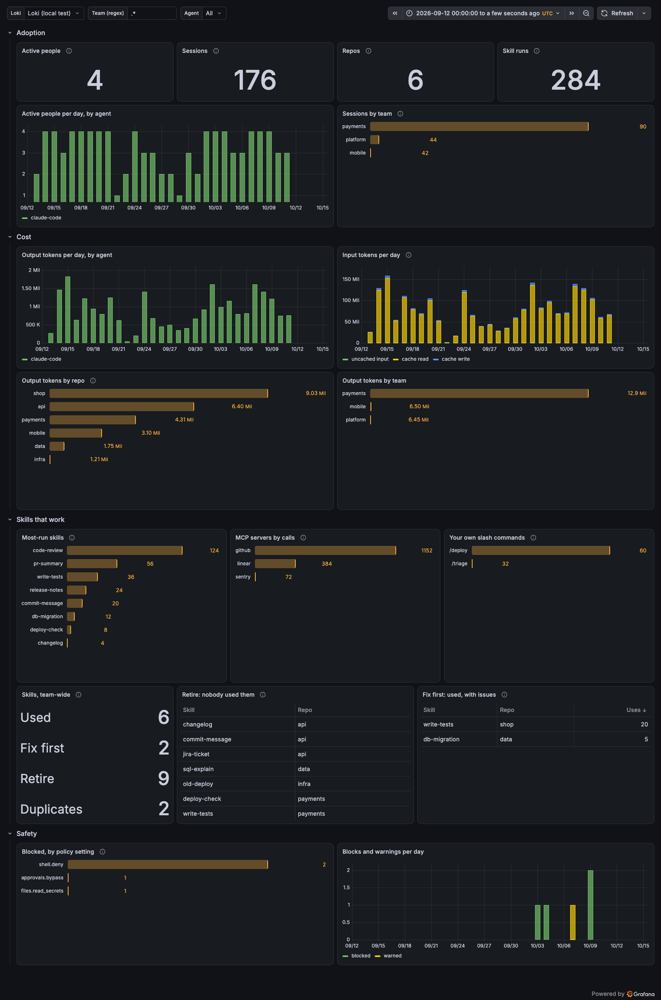

# Send roost's counts to your dashboards

`roost export` sends a small daily summary of what your agents used to your company's own OpenTelemetry backend: Grafana Cloud, a self-hosted Grafana with Loki, OpenObserve, or anything behind an OpenTelemetry Collector. A starter Grafana dashboard reads it.

<p align="center"></p>

<sub>Made-up data from `scripts/demo-home.mjs`.</sub>

## What is sent, and what never is

Each row is one day × agent × repo, plus the item it's about. Every row also carries the team and a hashed person id.

| Event | One row per | Counts |
|---|---|---|
| `roost.activity` | day × agent × repo | sessions; tokens: input, cache read, cache write, output; skill runs; MCP calls |
| `roost.skill_used` | … × skill | runs, sessions |
| `roost.subagent_used`, `roost.command_used` | … × subagent / slash command | runs or uses, sessions, whether it's built in |
| `roost.mcp_used` | … × MCP server | calls, tools used, sessions |
| `rookery.policy` | … × rule | how often rookery's hook blocked or warned (from `~/.rookery/decisions/`) |
| `roost.verdict` | skill (latest day) | keep / improve / merge / retire / no-data, uses, issues: only with `--rookery` |
| `roost.run` | job × agent × repo, from `roost pipeline` | tokens, skills used, MCP calls; outcome (merged / failed / retried) and the PR or ticket id as labels |

**Never sent:**
- prompts, replies or code;
- tool arguments or results;
- file paths beyond the repo name, or the command text rookery blocked;
- your email. The person id is `sha256(ROOST_PERSON_SALT + git email)`, cut to 16 characters.

**Repos** are named `host/org/repo` from the git remote. Credentials in the URL are dropped, and `github.com-work`-style SSH aliases are folded into `github.com`.

**See it yourself:**
- `roost export` shows exactly which rows would go, and sends nothing;
- `--format json` lists every row;
- `--format otlp` prints the exact payload.

## Pipeline mode: for headless and CI agents

`roost usage`, `roost verdicts` and `roost context` all read a person's own interactive sessions. `roost pipeline` is for the other kind: an agent running unattended in CI, merging code with nobody watching. Call it once, at the end of the job, in the same runner the agent used:

```bash
npx @thinkingraven/roost pipeline --agent claude-code --outcome merged --pr 123
```

It reads whichever session is newest under `--home` (an ephemeral CI runner has exactly one), and reports the job's cost, the skills it ran, and the outcome you pass in. `--job` defaults to `GITHUB_RUN_ID` (or `CI_JOB_ID`, `BUILD_ID`) if you don't set one. Preview by default; `--send` posts it through the exact same OTLP pipeline and `ROOST_EXPORT=on` opt-in as `roost export` — same settings, same one network call.

What it can't do: know the outcome before you do. If your workflow opens a PR and finishes before the PR merges, call `roost pipeline --outcome merged` from whatever later step learns that (a required status check, a scheduled job, a "PR merged" trigger) — not the step that ran the agent.

## The network rule

This is the only kind of thing roost sends over the network — `roost export --send` and `roost pipeline --send`. Two things are needed:
- **an address:** `OTEL_EXPORTER_OTLP_ENDPOINT`, or `--endpoint`;
- **an explicit yes:** `ROOST_EXPORT=on`, or passing `--endpoint` yourself.

Having the OpenTelemetry variables set, for example for Claude Code's own telemetry, is not enough.

## Grafana Cloud in five minutes

1. **Get the endpoint and a token.** In your Grafana Cloud stack, open **OpenTelemetry → Configure**. Note the OTLP endpoint (`https://otlp-gateway-<region>.grafana.net/otlp`) and the instance ID, then create a token with `logs:write`.
2. **Set the variables.** Put the login in the header as base64 of `instanceID:token`:
   ```bash
   export OTEL_EXPORTER_OTLP_ENDPOINT=https://otlp-gateway-prod-eu-west-2.grafana.net/otlp
   export OTEL_EXPORTER_OTLP_HEADERS="Authorization=Basic%20$(printf '123456:glc_…' | base64)"
   export ROOST_EXPORT=on
   export ROOST_TEAM=payments
   export ROOST_PERSON_SALT=<a company secret>
   ```
3. **Preview, then send:** run `npx @thinkingraven/roost export`, check it, then `npx @thinkingraven/roost export --send`.
4. **Import the dashboard.** In Grafana: **Dashboards → New → Import**, upload [`dashboards/grafana/roost.json`](../dashboards/grafana/roost.json), and pick your Grafana Cloud Logs (Loki) data source.

New rows are queryable within an hour or two. Loki writes rows dated to an earlier day into storage before it can query them.

## Company-wide rollout

The DevEx or platform team does this once, through device management. Developers do nothing.

- **Variables on every machine:** set the ones above, with each machine's team in `ROOST_TEAM`.
- **A daily job:** a launchd agent, cron or Task Scheduler, running a pinned version:
  ```bash
  npx -y @thinkingraven/roost@0.3.0 export --send
  ```
  It sends the finished days not sent yet, and remembers them in `~/.roost/export-state.json`.
- **Verdicts too:** run rookery first and pass its report:
  ```bash
  npx -y @thinkingraven/rookery scan ~/code --local --format json > /tmp/rookery.json
  npx -y @thinkingraven/roost export --send --rookery /tmp/rookery.json
  ```

How it behaves:
- **Days and window:** days are UTC and only finished days are sent; today waits for tomorrow.
- **A machine that was off:** it sends at most the last 7 days on its own. Most log stores reject older entries, Loki among them, so `--since` older than that may be refused.
- **One stream per person:** each person (or each machine, with `ROOST_PERSON=none`) is its own stream (`service.instance.id`). One person's late send never collides with another's newer data.
- **Failures:** a failed send marks nothing as sent and is retried the next day. A partial rejection is reported and exits with code 1.
- **Duplicates:** every row has a stable `roost.row_id`, the same person, day, agent, repo and item always giving the same id. A re-send with `--since` adds duplicates in Loki, so avoid re-sending to the same backend.

## Settings

| Variable | Meaning |
|---|---|
| `OTEL_EXPORTER_OTLP_ENDPOINT` | Base URL; roost posts to `<base>/v1/logs` |
| `OTEL_EXPORTER_OTLP_LOGS_ENDPOINT` | Full logs URL, used as is (wins) |
| `OTEL_EXPORTER_OTLP_HEADERS`, `…_LOGS_HEADERS` | `key=value,…`, values URL-encoded (`Authorization=Basic%20…`) |
| `OTEL_RESOURCE_ATTRIBUTES` | Extra `key=value` labels on everything sent |
| `ROOST_EXPORT=on` | The opt-in |
| `ROOST_TEAM` | Team label (or `--team`) |
| `ROOST_PERSON` | `hashed` (default) or `none`, for no person id; a random per-machine id still keeps streams apart |
| `ROOST_PERSON_SALT` | Company secret mixed into the person hash |
| `ROOST_REPO` | `remote` (default, `host/org/repo`), `name` (folder name) or `none` |
| `ROOKERY_HOME` | Where rookery's decision log lives (default `~/.rookery`) |

roost sends OTLP over HTTP as JSON. `grpc` is refused with a clear error.

## In Loki and Grafana

Loki keeps `service_name="roost"` and `service_instance_id` as stream labels, and every attribute as structured metadata, with dots turned into underscores: `roost.tokens.output` becomes `roost_tokens_output`. For example:

```logql
sum by (roost_skill) (sum_over_time({service_name="roost"} | event_name="roost.skill_used" | unwrap roost_runs [$__range]))
```

Verdicts are per person, since each export judges against that person's sessions. The dashboard therefore adds everyone's usage per skill and repo before calling something "retire" (nobody used it, though it was available) or "fix first" (used, and rookery found issues).

The dashboard is generated by `scripts/gen-grafana-dashboard.mjs` (`npm run dashboard`). Its queries were checked against Loki 3.7, and the dashboard against Grafana 13.2.

## Other backends

- **OpenObserve:** set `OTEL_EXPORTER_OTLP_ENDPOINT=https://<host>/api/<org>` and `Authorization=Basic%20<base64 user:password>`; add `stream-name=roost` to the headers for its own stream. No starter dashboard yet.
- **Observe:** its OTLP endpoint takes protobuf only, and roost sends JSON. Until roost can encode protobuf, put an OpenTelemetry Collector in between: an `otlp` receiver, then an `otlphttp` exporter to Observe.
- **Anything else** (Datadog, Honeycomb, New Relic, Splunk…): point roost at an OpenTelemetry Collector, or at the vendor's OTLP/HTTP logs intake if it takes JSON.
